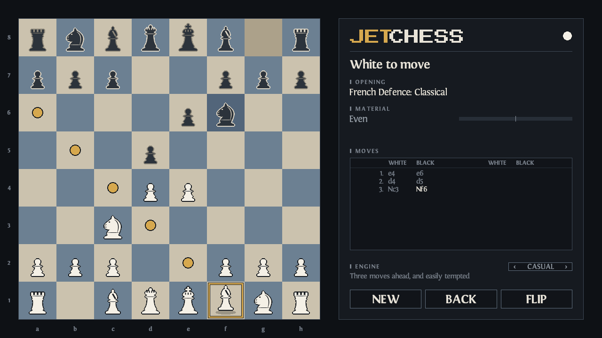

# JetChess

A chess machine for the [Jet64 fantasy console](https://73v3.itch.io): a real
engine, a real opening book, and a board you can pick pieces up off.



* **Play it with the mouse.** Press a piece and it comes up under the pointer
  and travels with it; let go over a square and it goes there. Or click a
  piece and then click where it should go — whichever you already do.
* **It plays properly.** Alpha-beta with a transposition table, killer moves, a
  history heuristic, null-move pruning, late move reductions and a quiescence
  search that will not stop counting in the middle of an exchange. On a desktop
  it thinks on a worker thread, so the board never so much as ripples.
* **Three opponents.** *Casual* looks three moves ahead and is easily tempted.
  *Club* looks five and rarely misses a tactic. *Master* looks eight and plays
  the best it finds.
* **It knows the openings.** Ninety lines, from the Ruy López to the Najdorf,
  and it names them as you reach them — yours as readily as its own.
* **It writes the game down**, in the algebraic notation a chess book uses,
  disambiguation and all: `Nbd2`, `exd5`, `O-O-O`, `e8=Q+`, `Qxf7#`.
* **It tells you where you stand.** A bar that says how far ahead, a figure
  that says how far ahead in pawns, and the pieces you are actually up.
* **It remembers.** Close it mid-game and it opens on the same position, with
  the same moves behind it, the same opponent and the board the same way round.

## Playing

| | |
|---|---|
| move a piece | press and drag it, or click it and click its square |
| take a piece | drag onto it — a ring marks what can be taken |
| promote a pawn | the board goes quiet and a card offers four pieces; click one |
| **N** or NEW | a new game |
| **U** or BACK | take your move back |
| **F** or FLIP | turn the board round |
| **L** or the level button | change the opponent |
| **R** | show the frame rate, or stop showing it |

## How it is built

Three layers, and the boundaries between them are the point.

| | |
|---|---|
| `engine/` | pure chess, and not one console call. A 0x88 board, Zobrist hashing, move generation, evaluation, the search, algebraic notation and the opening book. It compiles and runs outside the machine, which is how `tests/jetchess` puts twenty-eight million positions through it in half a second. |
| `game/` | a *game* of chess: the scoresheet, the five ways a game can end, and when the opponent thinks. |
| `ui/` | the screen: the board, the panel, and the player's own hand, composited through the runtime's still-screen module (`jet_still.h`), which paints the whole thing once and thereafter restores only what moved. |

Two files sit beside those rather than inside one, because each is about the
game as a whole: `audio.h`, which turns what a move *did* into a sound, and
`save.h`, which writes down where the player left off.

### The four things worth reading the source for

**How it stays fast.** Almost nothing on a chess screen moves. So the screen is
painted once into working memory, and every frame after that is a memcpy of the
few rectangles the last frame disturbed, plus the handful of things that really
are moving. A still frame costs tens of microseconds instead of several hundred.
What gets baked and what gets drawn live is decided by a *fingerprint* — a
digest of every piece of state the picture is drawn from — so there is no "mark
the screen dirty" call for a new feature to forget. `jet_still.h` has the four
laws.

**How it thinks without stopping.** On a desktop the search runs on a worker
thread. In a browser there is no second thread, so the game loop does the
searching itself, three milliseconds at a time between frames, and the search
picks up where it left off. Both drive the same search — there is not one
`#ifdef` between them. `engine/search.h` says how.

**How it remembers.** A game of chess is not a picture of a board: it is a
starting array and the moves played from it, so that — with the opponent chosen
and which way round the board is — is all that is written down. Everything else
is *derived* by replaying those moves: the pieces' squares, the scoresheet in
its proper notation, the opening's name, whose turn it is, and how the game
ended. Nothing derived is stored, so nothing stored can disagree with the rules.
And the record is not saved by a call at the bottom of every move: it is encoded
once a tick and written only when it differs from the file, which is the same
closed ring the screen is composited by. A fact added to it cannot be a fact
some new code path forgets to save. `save.h` has the format and the reasoning.

**How it is set.** Every word on screen goes through one of four functions in
`ui/type.h`, and each of them positions the line by its INK rather than by its
glyph box — because a glyph cell is as tall as its face's line height and its
letter is not, and a column of five faces spaced by cells reads as five
separate decisions. The faces themselves are four cuts of one typeface baked
into sprite cells (`data/gfx/fonts.ron`): proportional, spaced by the letterform
the type designer drew, and anti-aliased by blending each edge pixel toward the
exact palette entry the panel is painted in — which is how a machine with no
alpha channel gets smooth type. One bake serves every colour the cart owns:
`ui/ink.h` builds a recolour table per voice, so the ramp is re-hued and the
soft edge survives instead of being stamped flat. And the whole column down the
panel is *computed* from the cap heights those faces bake to, anchored at the
panel's top and its floor, with a `_Static_assert` that the move list still
holds its twenty moves — so moving a type size moves the layout with it and
fails the build if it cannot.

## The art and the sounds

The twelve pieces are turned on a lathe by `scripts/jetchess_art.py` in the
Jet64 tree: a profile swept about a vertical axis, which is what a chess piece
actually is. The knight, the one piece that is not a body of revolution, is
drawn as a free outline. The same script designs the palette, because on a
machine with no alpha a soft edge survives only as a *ramp* of palette
entries, and the art has to be painted in the ramp's own colours.

The eight sounds are written by `scripts/jetchess_sfx.py`, also in that tree,
straight into the console's `.sfx` format. Open the cart's Sprite Editor and
the pieces are ordinary cells you can repaint; open the Instrument Studio and
the sounds are ordinary patches you can play — and the glyphs are ordinary
cells too, sitting in the same bank under the pieces, which is exactly what
makes the type in this cart something an artist can touch.

The typefaces and what is and is not redistributed are set out in
[data/FONT-NOTICE.md](data/FONT-NOTICE.md).

## Verifying it

The harness lives with the console rather than with the cart — from the root of
the Jet64 tree:

```bash
bash tests/jetchess/build.sh
```

Perft against the published counts for the six standard positions, every legal
move written and read back as itself, every opening line replayed as legal
chess, the search's mates and tactics, the five ways a game ends, a saved game
that comes back as the same game and cannot be damaged in any one bit without
being noticed, and the whole cart built and run on the real machine — all of it
under the address and undefined-behaviour sanitisers.

Made with Jet64. MIT licence — see [LICENSE](LICENSE).
